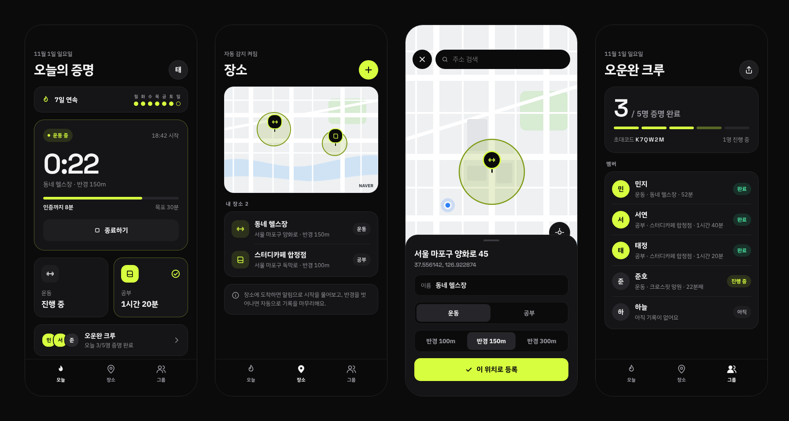
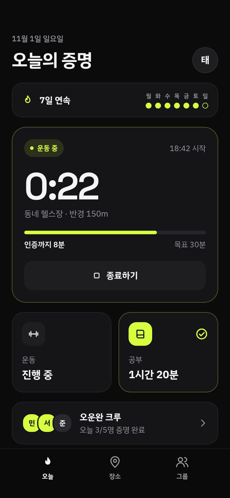
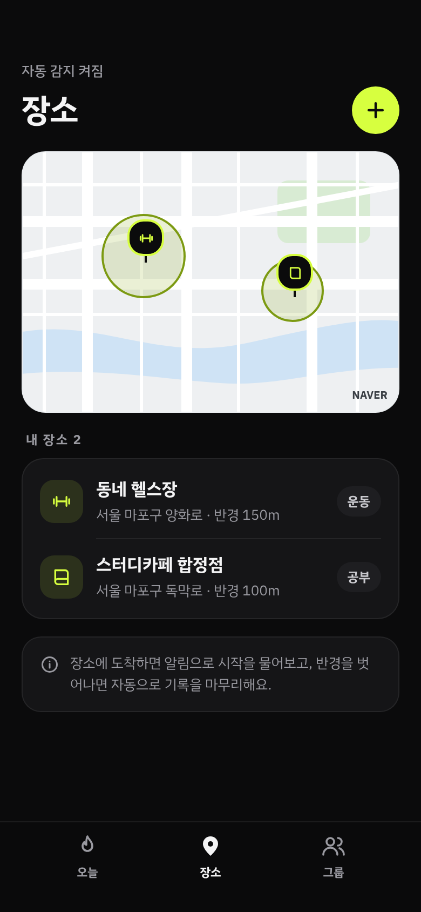
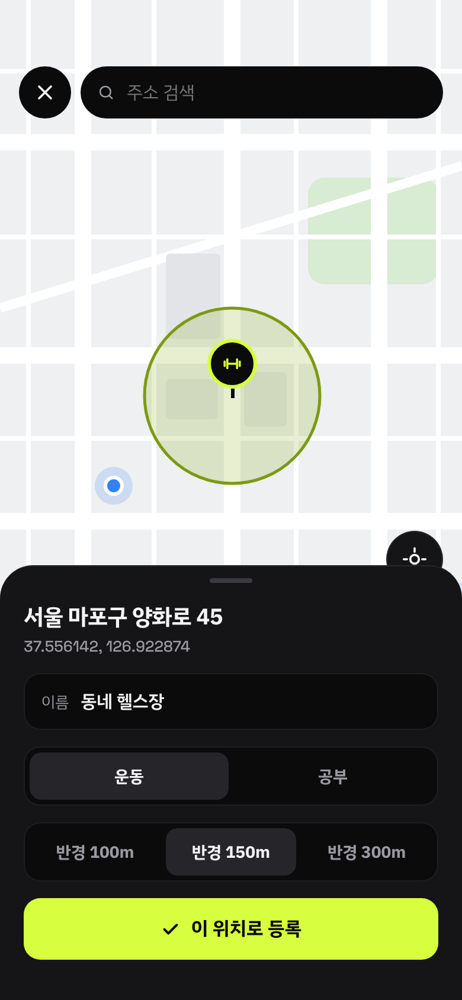
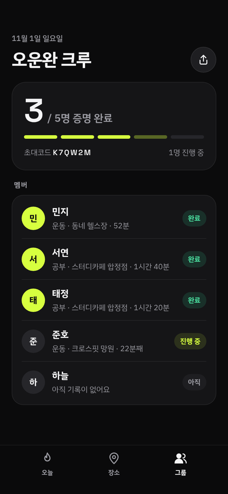

<div align="center">

# SHOW ME WHAT YOU GOT

**말로만 하는 다짐 말고, 증명하자.**
헬스장·독서실에 실제로 갔는지 위치로 증명하고, 그룹 친구들과 매일 서로 확인하는 동기부여 앱




</div>

<br>

## 서비스 소개

운동이든 공부든 **혼자서는 동기부여가 안 돼서 매번 실패하는 사람들**을 위한 앱입니다.
"오늘 운동했어"라는 말 대신, 앱이 **실제로 그 장소에 일정 시간 이상 머물렀는지**를 확인해서 증명해 줍니다.
그리고 그 증명을 그룹 친구들과 공유하면서 서로 자극을 주고받습니다.

### 핵심 기능

| 기능 | 설명 |
|---|---|
| 📍 **장소 등록** | 네이버 지도에서 헬스장·독서실 위치를 탭해서 등록하고, 감지 반경(100/150/300m)을 정합니다 |
| 🔔 **도착 감지** | 앱이 꺼져 있어도 등록한 장소에 도착하면 "시작할까요?" 알림이 옵니다 |
| ⏱️ **자동 기록** | 시작 후 장소를 벗어나면 자동으로 종료되고, 머문 시간을 기록합니다 |
| ✅ **증명 판정** | 최소 시간(운동 30분, 공부 60분)을 채우면 **증명 완료** |
| 📸 **사진 인증** | 진행 중에 앱으로 사진을 찍으면, 사진의 위치(EXIF, 없으면 촬영 순간의 GPS)와 시각이 장소·기록 시간 안인지 확인해 인증하고 그룹원에게 보여줍니다 |
| 🔥 **연속 기록** | 증명한 날이 이어지면 연속 일수와 이번 주 현황을 보여줍니다 |
| 👥 **그룹** | 6자리 초대코드로 그룹에 참여하고, 그룹원들의 오늘 증명 현황(완료 / 진행 중 / 아직)을 확인합니다 |

<br>

## 화면

<table>
  <tr>
    <th>오늘</th>
    <th>장소</th>
    <th>장소 선택</th>
    <th>그룹</th>
  </tr>
  <tr>
    <td></td>
    <td></td>
    <td></td>
    <td></td>
  </tr>
  <tr>
    <td>연속 기록, 진행 중 타이머와<br>인증까지 남은 시간,<br>운동/공부 현황, 그룹 요약</td>
    <td>등록한 장소와 감지 반경을<br>지도와 목록으로 확인</td>
    <td>현재 위치 기준 지도에서<br>탭한 좌표로 장소 등록</td>
    <td>그룹원별 오늘 증명 현황과<br>초대코드 공유</td>
  </tr>
</table>

<br>

## 동작 방식

```
[장소 등록]  지도에서 탭한 좌표 + 반경 → OS 지오펜스로 등록
     │
     ▼  (앱이 꺼져 있어도 OS가 앱을 깨워줌)
[장소 진입]  "동네 헬스장 도착! 시작할까요?"  [시작하기] [오늘은 패스]
     │  시작하기
     ▼
[진행 중]    타이머 시작, 그룹원에게 🔥 진행 중으로 표시
     │  장소 이탈(자동) 또는 종료 버튼(수동)
     ▼
[종료]       머문 시간 ≥ 최소 시간 ?  ✅ 증명 완료  :  ⚠️ 시간 부족
     │
     ▼
[동기화]     Supabase에 기록 업로드 → 그룹원 화면에 반영
```

- 기록은 **기기에 먼저 저장**(AsyncStorage)하고, 네트워크가 될 때 서버로 동기화합니다. 앱이 꺼진 상태에서 실행되는 백그라운드 작업도 기기 저장소만으로 동작합니다.
- 수동 시작은 **등록한 장소 반경 안에 있을 때만** 가능합니다. 그래야 "증명"이니까요.
- 처음 실행하면 온보딩 → 카카오 로그인 → 닉네임 설정을 거쳐 시작합니다. 닉네임은 카카오 닉네임으로 미리 채워지고, 프로필에서 언제든 바꿀 수 있습니다.
- 증명 완료 여부는 서버에서 시작·종료 시각으로 다시 판정하므로, 앱을 조작해도 기록을 위조할 수 없습니다.

<br>

## 기술 스택

| 분류 | 기술 | 용도 |
|---|---|---|
| **앱** | React Native 0.88 · Expo SDK 58 · TypeScript | iOS/Android 동시 개발 |
| **화면 이동** | Expo Router | 파일 기반 라우팅 (`src/app/` 파일 = 화면) |
| **위치 감지** | `expo-location` (지오펜싱) · `expo-task-manager` | 장소 도착/이탈 감지, 앱이 꺼져 있을 때 백그라운드 실행 |
| **사진 인증** | `expo-image-picker` · `expo-image-manipulator` · Supabase Storage | 앱 내 촬영, EXIF 위치 판독, 압축 후 비공개 저장소 업로드 (본인·그룹원만 열람) |
| **알림** | `expo-notifications` | 도착 알림(시작/패스 버튼), 증명 완료 알림 (기기 내 로컬 알림) |
| **지도** | 네이버 지도 (`@mj-studio/react-native-naver-map`) | 장소 선택, 등록 장소 표시 |
| **로그인** | 카카오 로그인 (Supabase Auth OAuth) | 온보딩 후 카카오로 시작, 닉네임은 카카오 닉네임으로 자동 채움 |
| **서버** | Supabase (Postgres · Auth · RLS, 서울 리전) | 그룹, 기록 공유. 같은 그룹끼리만 조회 가능한 행 단위 권한, 서버 측 증명 판정 |
| **기기 저장소** | AsyncStorage | 장소, 진행 중 세션, 기록 |
| **디자인** | Claude Design · IBM Plex Sans KR · Space Grotesk · Ionicons | 시안 제작, 글꼴, 아이콘 |
| **빌드/배포** | Expo 개발 빌드 · EAS Build/Submit | 로컬 실기기 테스트, 스토어/TestFlight 배포 |

<br>

## 프로젝트 구조

```
show_me_what_you_got/
├── index.ts                    # 앱 진입점. 지오펜스 백그라운드 작업을 가장 먼저 등록
├── app.json                    # 앱 이름, 패키지명, 권한, 플러그인 설정
├── app.config.ts               # .env 의 지도 키 등 비밀 값을 네이티브 설정에 주입
├── eas.json                    # EAS 클라우드 빌드 프로필 (development / preview / production)
├── .env.example                # 환경변수 견본 (복사해서 .env 로 사용)
├── supabase/
│   └── schema.sql              # DB 테이블 · 권한(RLS) · 함수
├── docs/screenshots/           # README 이미지
└── src/
    ├── app/                    # 📱 화면 (Expo Router)
    │   ├── _layout.tsx         #   최상위: 글꼴, 로그인 상태별 화면 분기, 알림 응답, 서버 동기화
    │   ├── onboarding.tsx      #   온보딩 (앱 소개 3장)
    │   ├── login.tsx           #   카카오 로그인
    │   ├── profile-setup.tsx   #   첫 로그인 후 닉네임 정하기
    │   ├── profile.tsx         #   프로필: 닉네임 수정, 로그아웃
    │   ├── (tabs)/
    │   │   ├── _layout.tsx     #   하단 탭 (오늘 / 장소 / 그룹)
    │   │   ├── index.tsx       #   오늘: 연속 기록, 진행 중 세션, 현황, 그룹 요약
    │   │   ├── places.tsx      #   장소: 지도 + 목록
    │   │   └── groups.tsx      #   그룹: 닉네임, 참여/생성, 내 그룹 목록
    │   ├── place/new.tsx       #   장소 선택 (네이버 지도 탭)
    │   └── group/[id].tsx      #   그룹 상세: 멤버별 오늘 현황
    ├── components/
    │   ├── ui.tsx              # 🎨 디자인 시스템 (색 · 글꼴 · 버튼 · 카드 · 세그먼트 등)
    │   └── brand.tsx           #   로고, 카카오 로그인 버튼
    └── lib/                    # 🧠 로직
        ├── geofence.ts         #   지오펜스 등록, 도착 → 알림 / 이탈 → 자동 종료
        ├── sessions.ts         #   세션 시작 · 종료 · 증명 판정 · 서버 동기화
        ├── notifications.ts    #   알림 채널, 버튼, 알림 내용
        ├── responses.ts        #   알림 버튼을 눌렀을 때 처리
        ├── photoProof.ts       #   사진 인증 (촬영 → 위치·시각 확인 → 업로드)
        ├── exif.ts             #   사진 EXIF 에서 위치·시각 읽기 (iOS/Android 형식 모두)
        ├── places.ts           #   장소 추가/삭제 + 지오펜스 갱신
        ├── stats.ts            #   연속 기록, 이번 주 현황 계산
        ├── groups.ts           #   그룹 API (생성 · 참여 · 오늘 현황)
        ├── auth.ts             #   카카오 로그인 / 로그아웃
        ├── session.tsx         #   로그인 상태 (로그아웃 / 닉네임 필요 / 준비 완료)
        ├── haptics.ts          #   진동 규칙
        ├── supabase.ts         #   서버 클라이언트
        ├── storage.ts          #   기기 저장소
        ├── types.ts            #   타입, 최소 인증 시간(MIN_MINUTES)
        └── utils.ts            #   거리 계산, 시간 포맷 등
```
